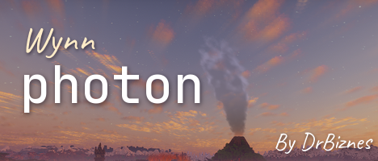

# WynnPhoton

WynnPhoton patches the [Photon](https://modrinth.com/shader/photon-shader) shader pack for Wynncraft and works alongside WynnIris. It ships only patches, never Photon itself (make sure to download it seperately!), and builds the patched pack when the game starts. Made for my modpack [World of Wynncraft](https://modrinth.com/modpack/world-of-wynncraft)

**Important notice: Please don't report any bugs while using Wynn-Photon to SixthSurge or Photon. My contact information is below.**

## What's Up

- Fog, clouds and caves fit Wynncraft's sea level
- Lighting fixes across the map, so caves and rooms aren't pitch black anymore
- Wynncraft's custom blocks light up and shade like they look
- Its own Wynn-Photon page in the shader settings
- Updates itself, just drop in the new jar and your shader settings carry over
- Works with Photonics, WynnVista, WynnIris, Voxy and Distant Horizons

## See It

<!-- screenshot -->

<!-- screenshot -->

<!-- screenshot -->

## Installation

1. Install Fabric Loader and WynnIris
2. Put `photon_v1.4.zip` from [Modrinth](https://modrinth.com/shader/photon-shader/versions) in your `shaderpacks` folder, still zipped and unedited
3. Put the Wynn-Photon jar from the releases page in your `mods` folder
4. Start the game, it makes `photon_v1.4 + WynnPhoton_<version>` and selects it

## Go Ham

- Feel free to use this in your modpack
- How it's built and tested is in the [development docs](docs/DEVELOPMENT.md)
- Photon is © SixthSurge under the [Photon Shaders License Agreement](https://github.com/sixthsurge/photon/blob/main/LICENSE)
- Wynn-Photon's own code is [MIT](LICENSE)

## Acknowledgments

- Thanks to SixthSurge for Photon
- Thanks to the Wynncraft team for creating an awesome MMORPG experience in Minecraft

## Support and My Mods
Please report any bugs or feature suggestions on the Github Issues page! You can also [join my discord](https://discord.gg/jqFF64rXZZ) if you need direct support, or want to stay updated with all of my mods.
### Check out all my projects!
>   [World of Wynncraft Modpack](https://modrinth.com/modpack/world-of-wynncraft)

>   [WynnTitles](https://modrinth.com/mod/wynntitles)

>   [WynnWanderer](https://modrinth.com/mod/wynnwanderer)

>   [WynnVista](https://modrinth.com/mod/wynnvista)

>   [Wynn Weapon Bigger](https://modrinth.com/mod/wynnweaponbigger)

>   [Nimble ReWynnded](https://modrinth.com/mod/nimble-rewynnded)

>   [Class Keybind Profiles](https://modrinth.com/mod/class-keybind-profiles)

>   [WynnBubbles](https://modrinth.com/mod/wynnbubbles)

>   [WynnLODGrabber](https://modrinth.com/mod/wynnlodgrabber)
